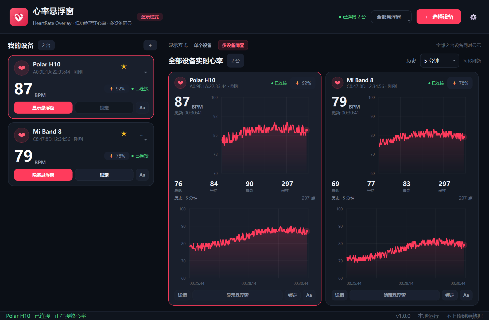

# 心率悬浮窗 · HeartRate Overlay

一个面向 Windows 的桌面心率显示工具：通过低功耗蓝牙（BLE）读取手环 / 手表 / 心率带的
标准心率服务，把心率显示在可自由定制、始终置顶、可锁定点击穿透的悬浮窗中。
支持同时连接多台设备、多悬浮窗、心率历史折线图和收藏设备快速重连。

> 参考项目：[ccc007ccc/HeartRateMonitor](https://github.com/ccc007ccc/HeartRateMonitor)
> （本项目的界面、样式系统、多设备架构与链路均为重新实现）




## 下载与运行

GitHub Release 推荐下载 **`心率悬浮窗安装程序.exe`**（本仓库 `release/` 中已生成）。
双击安装程序后选择安装目录，安装完成会在桌面创建快捷方式。

默认安装到 `%LOCALAPPDATA%\Programs\HeartRateMonitor`。
安装器会请求管理员权限。
- 安装目录内的 `cache` 保存配置、心率历史和日志，避免系统用户目录权限问题。
- 安装目录内的 `uninstall.exe` 可卸载程序，Windows“已安装的应用”中也会显示卸载项。
- 安装目录包含完整运行文件，不需要另外复制 `_internal` 文件夹。
- `release/心率悬浮窗.exe` 仍保留为免安装版本；首次运行可能使用当前用户专属的
  LocalAppData 目录作为缓存。
- 不支持 Windows 7；需要 Windows 10 / 11 64 位和可用的蓝牙适配器。

> Windows SmartScreen 提示「未知发布者」是未签名程序的正常提示：
> 右键安装程序 → 属性 → 勾选「解除锁定」；运行时点「更多信息 → 仍要运行」。
> 文件哈希见 `docs/SHA256SUMS.txt`。

## 操作流程

1. **从桌面快捷方式**打开主窗口。
2. 点击右上角 **「＋ 选择设备」**。
3. 在弹出的窗口中点击 **「开始扫描」**，勾选一个或多个设备，点击
   **「连接所选设备」**（也可以点单行的「连接」）。
4. 连接成功后，主窗口会实时显示心率；在左侧设备卡片点击 **「显示悬浮窗」**。
5. 悬浮窗出现后可以直接拖动到任意位置；点击 **「锁定」** 后悬浮窗会点击穿透，
   不会挡住游戏或桌面操作。
6. 需要再次移动时，从主窗口 / 托盘菜单 / 快捷键 `Ctrl+Alt+L` 解锁。

> 设备需要支持标准 BLE Heart Rate Service（0x180D / 0x2A37）。很多手环需要在
> 官方 App 中开启「心率广播」，并且最好先断开手机与手环的连接，否则手环可能拒绝
> 电脑连接。

## 主要功能

### 悬浮窗

- 格式默认为 `❤{bpm}`，可完全自定义：
  - 显示模板：`{bpm}` 心率、`{heart}` 心形字符、`{name}` 设备名、`{battery}` 电量、`{time}` 时间
  - 心形字符（❤ / ♥ / ♡ / 💓 等）
  - 字体下拉框、字号、粗体、斜体
  - 字符间距
  - 心形颜色、数字颜色、其他文字颜色
  - 背景颜色与背景不透明度（0 = 完全透明）
  - 文字描边颜色 / 粗细、阴影颜色 / 浓度
  - 内边距、圆角、整体不透明度
- 字号、间距、内边距、圆角、描边等数字输入框右侧都有上下调节箭头。
- 内置「经典红心 / 极简数字 / 霓虹描边 / 设备名称」预设。
- 每台设备可以保存独立样式；新设备可使用默认样式。
- 悬浮窗整个框都可以拖动；四个角都可拖动缩放，文字随框大小缩放。
- 悬浮窗正下方中心有「锁定 / 隐藏」按钮，随框宽度自动居中；锁定后按钮隐藏并点击穿透。
- 悬浮窗自动适应数字宽度；拖动位置、自定义大小、锁定状态、显示状态都会记住。

### 多设备

- 同时连接多个手环 / 手表，每个设备一个独立悬浮窗。
- 主窗口支持**多设备同显**：所有设备的心率、最低 / 平均 / 最高 / 采样、3 分钟实时曲线和
  所选范围的历史曲线同时以紧凑卡片展示。
- 多设备视图顶部可统一切换历史范围（5 分钟 / 30 分钟 / 1 小时 / 6 小时 / 24 小时）。
- 顶部「单个设备 / 多设备同显」可随时切换；多设备卡片上的「详情」可切换到单个设备大图。
- 左侧设备列表把已断开的设备单独放入「已断开」分组，点击分组标题可折叠 / 展开。
- 设备卡片独立显示当前心率、电量、连接状态。
- 可在设备选择窗口中一次勾选多个设备同时连接。

### 历史与曲线

- 心率按秒写入本机 SQLite，右侧提供实时曲线和 5 分钟 / 30 分钟 / 1 小时 / 6 小时 / 24 小时历史曲线。
- 曲线每秒刷新（蓝牙数据到达时悬浮窗立即刷新）。
- 支持导出 CSV、清空单设备历史、设置历史保留天数。

### 收藏与持久化

- 设备地址、名称、样式、悬浮窗位置、锁定状态都会保存。
- 扫描结果或设备卡片上点 ☆ 收藏；下次打开「选择设备」时可在「收藏 / 常用」中一键连接。
- 可设置启动时自动重连收藏设备。
- 支持关闭到系统托盘，退出前保持蓝牙连接和悬浮窗。

## 全屏说明（重要）

程序使用 `WindowStaysOnTopHint` + Win32 `SetWindowPos(HWND_TOPMOST)` 定时增强置顶，
并且窗口不抢焦点、不出现在 Alt+Tab。

- **无边框全屏 / 窗口化全屏**：悬浮窗会保持在游戏画面之上。这是推荐用法。
- **独占全屏（Exclusive Fullscreen）**：Windows 会绕过桌面合成器，任何普通窗口都无法
  显示在其上。这是系统限制，不是本程序能绕过的；请在游戏里改为「无边框窗口」或
  「窗口化全屏」。设置页对此也有说明。

## 快捷键与托盘

| 操作 | 快捷键 |
| --- | --- |
| 锁定 / 解锁当前（或全部可见）悬浮窗 | `Ctrl+Alt+L` |
| 显示 / 隐藏全部悬浮窗 | `Ctrl+Alt+H` |

关闭主窗口默认最小化到系统托盘，右键托盘图标可显示主窗口、选择设备、显示/隐藏/锁定全部
悬浮窗或退出。可在设置中关闭「关闭到托盘」。

## 数据位置

安装版默认目录：`安装目录\cache\`

| 文件 | 内容 |
| --- | --- |
| `config.json` | 设备、收藏、样式、窗口位置等设置 |
| `history.sqlite3` | 心率历史 |
| `app.log` | 运行日志（排查蓝牙问题时可查看） |

便携数据目录：设置环境变量 `HEART_RATE_OVERLAY_DATA_DIR` 指向任意可写目录即可。
例如：

```powershell
$env:HEART_RATE_OVERLAY_DATA_DIR = "D:\HeartRateData"
.\心率悬浮窗.exe
```

## 从源码运行 / 构建

环境：Windows 10 / 11，64 位 Python 3.12（或 3.10+）。

```powershell
python -m venv .venv
.\.venv\Scripts\python.exe -m pip install -r requirements-dev.txt

# 直接运行（模拟设备，无需蓝牙硬件）
.\.venv\Scripts\python.exe -m app.main --demo

# 正常模式
.\.venv\Scripts\python.exe -m app.main

# 单元 / 集成测试
.\.venv\Scripts\python.exe -m unittest discover -s tests -v

# 1) 构建 onedir 运行时
.\.venv\Scripts\python.exe -m PyInstaller --noconfirm --clean HeartRateOverlay_onedir.spec

# 2) 封装成单文件 exe（输出到 release\心率悬浮窗.exe）
powershell -ExecutionPolicy Bypass -File tools\build_single_exe.ps1 `
  -SkipBuild -SourceDir dist_onedir\HeartRateOverlay

# 3) 构建安装程序（输出到 release\心率悬浮窗安装程序.exe）
powershell -ExecutionPolicy Bypass -File tools\build_installer.ps1
```

也可以直接运行 `.\build.ps1` 自动完成以上两步。

安装程序把 onedir 运行时和安装后启动器嵌入安装包；安装时解压到用户选择的目录，
并创建桌面快捷方式。安装后启动器将 `HEART_RATE_OVERLAY_DATA_DIR` 指向安装目录的
`cache` 文件夹。

开发辅助参数：

```text
--demo               使用模拟设备（独立的 demo 配置与历史库）
--scan-test [SECONDS] 只扫描 BLE 并写日志，用于验证蓝牙后端
--smoke-test         启动约 3.5 秒后自动退出，用于验证打包
--screenshot DIR     演示模式截图后退出
```

## 项目结构

```text
app/
  main.py            入口 / 单实例 / 截图与扫描测试参数
  main_window.py     主窗口、设备卡片、曲线联动、托盘、热键
  ble_service.py     Bleak 多设备 BLE 服务 + 演示数据源
  overlay.py         无边框半透明置顶悬浮窗（拖动 / 锁定 / 穿透）
  render.py          悬浮窗文本排版与绘制（字符间距、颜色、描边、阴影）
  charts.py          无第三方依赖的折线图
  dialogs.py         悬浮窗样式编辑器
  dialogs_device.py  蓝牙设备选择 / 收藏
  dialogs_settings.py 设置
  history_store.py   SQLite 历史记录
  models.py          配置数据模型
  storage.py         配置路径与原子保存
  win32_utils.py     Win32 置顶 / 点击穿透 / 热键
assets/              图标与勾选素材
docs/                发布说明 / 使用说明 / 校验值
tests/               19 个单元 / 集成测试
tools/               构建脚本、启动器、安装器与开发辅助脚本
release/             最终 exe 与安装程序（二进制，不提交 git）
```

## 已验证

- 19 个自动化测试：心率包解析、配置归一化、历史查询/CSV、排版、悬浮窗拖动/缩放/控制栏/置顶/点击穿透、多设备视图、已断开分组、主窗口连接流程。
- 源码模式 Demo：双设备接入、双悬浮窗、图表与样式编辑器截图。
- 安装包资源检查：包含 228 个运行文件、安装后启动器，并能创建桌面快捷方式。
- 安装版主程序：Demo 双设备接入、退出码 0 正常，数据写入安装目录 `cache`。
- 单文件 exe 真实 BLE 扫描：发现 11 台附近设备并正常结束。
- Win32 窗口属性检查：`WS_EX_TOPMOST`、锁定后的 `WS_EX_TRANSPARENT` 均生效。

## 已知限制

- 只支持标准 BLE 心率服务；不读取厂商私有协议。部分设备需要在官方 App 中开启广播。
- 独占全屏无法被普通窗口覆盖（见上文）。
- 未做代码签名，SmartScreen 可能提示未知发布者。
- 安装程序未做代码签名，SmartScreen 可能提示未知发布者。
- 心率数据仅供参考，不构成医疗建议。

## GitHub 发布

仓库已经按 GitHub Release 的形式准备好：

- `release/心率悬浮窗安装程序.exe`：推荐发布文件，负责安装、创建桌面快捷方式和安装目录缓存；
- `release/心率悬浮窗.exe`：免安装备用版本；
- `docs/SHA256SUMS.txt`：发布文件校验值；
- `docs/RELEASE_NOTES.md`：可直接粘贴到 GitHub Release 的说明；
- `.github/workflows/build.yml`：推送 `v*` 标签时自动测试、构建发布文件并创建 Release；
- `LICENSE`、`CHANGELOG.md`、`.gitattributes`、`.gitignore` 已补齐。

发布步骤：

```powershell
git tag v1.0.0
git push origin v1.0.0
```

GitHub Actions 会自动构建安装程序和免安装版并附加到 Release。
也可以手动在 GitHub 页面新建 Release，上传 `release/心率悬浮窗安装程序.exe`、
`release/心率悬浮窗.exe` 和
`docs/SHA256SUMS.txt`。

## License

本项目采用 [MIT License](LICENSE)。参考项目
[ccc007ccc/HeartRateMonitor](https://github.com/ccc007ccc/HeartRateMonitor)
遵循其原始许可证；本仓库未复制其源代码。


